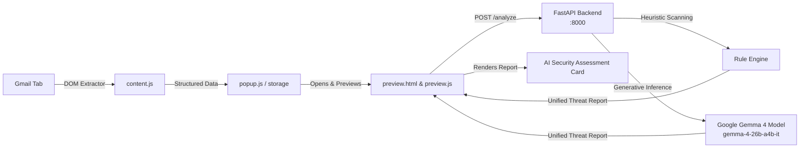

# 🛡️ ScamLens — AI-Powered Email Scam & Phishing Guardian

**ScamLens** is an intelligent, real-time email security extension that detects scams, phishing attempts, and social engineering attacks directly inside **Gmail**. 

Powered by a hybrid security pipeline combining **Deterministic Heuristic Rules** and **Google Gemma 4 (`gemma-4-26b-a4b-it`)**, ScamLens analyzes incoming email content, unmasks hidden malicious intent, and provides actionable safety advice before you click or respond.

---

## 🌟 Key Features

- **📬 1-Click Gmail Ingestion**: Extracts subject, sender details, recipient, date, plain-text body, and hyperlinked URLs directly from the active Gmail message.
- **🛡️ Two-Layer Hybrid Analysis**:
  - **Layer 1 (Fast Rule Engine)**: Deterministic heuristic scanning for urgency cues, OTP requests, account lockout threats, and known URL obfuscations (e.g. `@` symbols, link shorteners).
  - **Layer 2 (Google Gemma 4 AI)**: Deep cognitive analysis detecting subtle psychological manipulation, artificial panic, spoofing, and social engineering.
- **📊 Real-Time Security Assessment Dashboard**:
  - **Threat Level Badge**: `SAFE / LOW RISK`, `SUSPICIOUS`, or `HIGH RISK`.
  - **Risk Score Gauge**: 0% to 100% computed threat index.
  - **AI Scam Explanation**: Context-aware reasoning generated directly by Gemma 4.
  - **Identified Warning Signs**: Bulleted list of detected threat markers.
  - **Recommended Safety Actions**: Clear guidance on what the recipient should do.
- **🔒 Privacy & Security by Design**:
  - Content is treated as untrusted data; scripts and styling are stripped before evaluation.
  - Google redirect links (`google.com/url?q=...`) are unwrapped to inspect the destination URL safely.
  - Secret API keys remain secured in local `.env` and are never exposed to the client or GitHub.

---

## 🏗️ System Architecture



---

## 📂 Project Structure

```
Paytm_Hack/
├── Extension/                      # Chrome Extension (Manifest V3)
│   ├── manifest.json               # Extension configuration & host permissions
│   ├── popup.html                  # Toolbar popup interface
│   ├── popup.js                    # Popup controller & tab verification
│   ├── popup.css                   # Popup styling
│   ├── content.js                  # Safe Gmail DOM extractor
│   ├── background.js               # Extension service worker
│   ├── preview.html                # Factual preview & Gemma AI report dashboard
│   ├── preview.js                  # Frontend integration with backend API
│   ├── preview.css                 # Dark/light dashboard styling
│   ├── icons/                      # Extension icons (16px, 48px, 128px)
│   ├── tests/                      # Automated extractor test suite
│   ├── README.md                   # Extension-specific documentation
│   └── SETUP_INSTRUCTIONS.txt      # Quick installation cheat sheet
├── main.py                         # FastAPI backend service with Gemma AI integration
├── requirements.txt                # Python dependencies
├── .env.example                    # Template environment variables
├── .gitignore                      # Git ignore rules (protects .env & cache)
└── README.md                       # Main project documentation (this file)
```

---

## 🚀 Getting Started

### 1. Prerequisites
- **Python 3.10+**
- **Google Chrome** (or Chromium-based browser)
- **Gemini / Gemma API Key** (from [Google AI Studio](https://aistudio.google.com/))

---

### 2. Backend Setup

1. **Clone the repository**:
   ```bash
   git clone https://github.com/Anuja-3248/Paytm_Hack.git
   cd Paytm_Hack
   ```

2. **Install dependencies**:
   ```bash
   pip install -r requirements.txt
   ```

3. **Configure Environment Variables**:
   Create a `.env` file in the project root:
   ```env
   HOST=127.0.0.1
   PORT=8000
   ENVIRONMENT=development
   GEMINI_API_KEY=your_actual_gemini_api_key_here
   GEMMA_MODEL=gemma-4-26b-a4b-it
   ```

4. **Start the FastAPI server**:
   ```bash
   uvicorn main:app --reload --port 8000
   ```
   *The server will start at `http://127.0.0.1:8000`.*

5. **Verify Backend Health**:
   - Open [http://127.0.0.1:8000/docs](http://127.0.0.1:8000/docs) in your browser.
   - Run a test request on `POST /analyze` to ensure Gemma AI and rules respond with HTTP 200.

---

### 3. Chrome Extension Setup

1. Open Google Chrome and navigate to:
   ```
   chrome://extensions
   ```
2. In the top-right corner, toggle **Developer mode** to **ON**.
3. In the top-left corner, click **Load unpacked**.
4. Select the **`Extension`** folder from the cloned repository.
5. Click the puzzle icon 🧩 in your Chrome toolbar and **pin ScamLens** 🛡️.

---

## 🧪 Testing ScamLens Live on Gmail

1. Open **[Gmail](https://mail.google.com)** in Chrome.
2. Click and open any suspicious or legitimate email message.
3. Click the **ScamLens** icon in your toolbar and press **"Read Current Email"**.
4. The extension will:
   - Extract email metadata, body, and hyperlinked destinations.
   - Automatically open the **Preview & AI Security Assessment** tab.
   - Query the local backend at `http://127.0.0.1:8000/analyze`.
   - Display the **Gemma AI Threat Assessment**, warning flags, and recommendations in real time.

---

## 📡 API Reference

### `GET /`
Health check endpoint.
- **Response**: `{"status": "ok", "service": "ScamLens Backend"}`

### `POST /analyze`
Analyzes untrusted text or email content for fraud, phishing, and scam indicators.

#### Request Body
```json
{
  "content": "URGENT! Your bank account will be blocked today. Verify your account immediately and provide your OTP."
}
```

#### Response Body
```json
{
  "content": "URGENT! Your bank account will be blocked today...",
  "risk_level": "medium",
  "risk_score": 55,
  "details": "Some suspicious indicators were detected. Verify the sender and links independently.",
  "flags": [
    "Suspicious phrase detected: 'urgent'",
    "Suspicious phrase detected: 'otp'"
  ],
  "ai_analysis": "{\"risk_level\": \"high\", \"explanation\": \"The email uses extreme urgency and fear tactics ('blocked today') to induce panic. Most importantly, it requests an OTP (One-Time Password)...\", \"flags\": [\"Sense of urgency\", \"Fear-based social engineering\", \"Request for sensitive authentication data (OTP)\"], \"recommendation\": \"Do not reply to this email, do not click any links, and never share your OTP with anyone.\"}"
}
```

---

## 🔒 Security & Privacy

- **Safe Text Extraction**: Uses strict DOM `textContent` traversal to neutralize embedded malicious scripts, hidden iframe widgets, and XSS vectors.
- **Link Destructurizer**: Unmasks obfuscated redirect targets without triggering browser network navigation.
- **Prompt Injection Defense**: Gemma AI prompts explicitly treat email bodies as unverified external data within strict delimiter boundaries.
- **Zero Hardcoded Secrets**: Secrets and API keys are stored strictly in `.env` and excluded via `.gitignore`.

---

## 👥 Contributors
Developed for Paytm Hackathon by the **ScamLens Team**.
